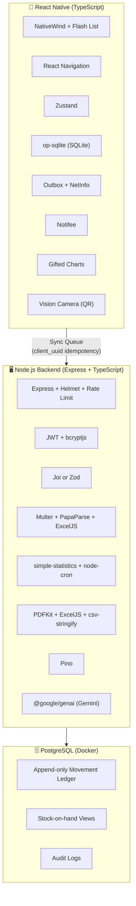
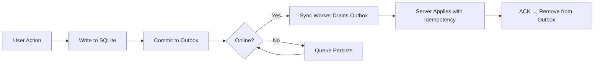

# Krāv Inventory System — Technology & Architecture Recommendations

Based on your Project Proposal's features, data model, and MoSCoW priorities, here is a comprehensive breakdown of recommended libraries and architectural patterns.

---

## Part 1: Library Recommendations by Feature Area

### 🔐 1. User & Access Management (Auth, Roles, PIN Login)

| Layer | Library | Why |
|-------|---------|-----|
| Backend — Password/PIN hashing | **bcryptjs** ✅ (from your list) | Pure JS bcrypt — no native compilation needed in Docker |
| Backend — Token auth | **jsonwebtoken** ✅ (from your list) | JWT generation & verification for session tokens |
| Backend — Input validation | **joi** ✅ (already installed) or **zod** ✅ (from your list) | Schema validation for login payloads, role guards. Pick one — Zod has better TypeScript inference if you migrate the backend to TS |
| Backend — Rate limiting | **express-rate-limit** ✅ (from your list) | Brute-force protection on PIN/password endpoints |
| Backend — Security headers | **helmet** ✅ (from your list) | Sets secure HTTP headers out of the box |
| Mobile — Secure storage | **react-native-keychain** or **expo-secure-store** | Store JWT/PIN hash securely on the device for offline login |
| Mobile — State (auth) | **zustand** | Lightweight global state for current user, role, and auth tokens |

> [!TIP]
> Between Joi and Zod, choose **one** for the entire project. Zod is more TypeScript-native and supports inferring types from schemas, which pairs well with your TS direction.

---

### 📦 2. Inventory List (Items, Categories, Custom Fields, Status)

| Layer | Library | Why |
|-------|---------|-----|
| Mobile — Performant lists | **@shopify/flash-list** | Handles 1,000+ items at 60fps — critical for your performance NFR (< 2s load) |
| Mobile — Search/filter | **fuse.js** | Client-side fuzzy search across item names, categories, and custom fields |
| Mobile — Navigation | **react-navigation** | Tab-based Bar/Kitchen split, stack navigation for item details |
| Mobile — Icons & status indicators | **react-native-vector-icons** or **lucide-react-native** | Color-coded status badges (OK, Low, Critical, Out, Overstock) |
| Backend — Pagination | **cursor-based pagination** (custom with `pg`) | Efficient keyset pagination for large item lists |

---

### 📄 3. CSV/XLSX Import & Schema Adaptation

| Layer | Library | Why |
|-------|---------|-----|
| Backend — Parse CSV | **papaparse** (or **csv-parse**) | Fast, streaming CSV parser with type detection |
| Backend — Parse XLSX | **xlsx** (SheetJS) or **exceljs** | Read .xlsx uploads, convert to JSON for the mapping wizard |
| Backend — File uploads | **multer** ✅ (from your list) or **express-fileupload** ✅ (from your list) | Multipart file upload handling. Pick one — multer is more battle-tested |
| Backend — Validation | **joi** or **zod** | Validate each imported row against core-field schemas |
| AI column mapping | **@google/genai** ✅ (from your list) | Use Gemini to suggest column-to-field mappings from header names. This is a great fit for the "AI-assisted column mapping" feature |

> [!IMPORTANT]
> For file uploads, choose **either** multer or express-fileupload, not both. Multer gives you more control over storage and file filtering.

---

### 📊 4. Stock Movement Ledger (In/Out/Waste/Adjustment)

| Layer | Library | Why |
|-------|---------|-----|
| Backend — Database | **pg** ✅ (already installed) | PostgreSQL driver — append-only ledger with `client_uuid` for idempotent syncs |
| Backend — Transactions | **pg** transactions | Wrap movement + outbox inserts in `BEGIN/COMMIT` for atomicity |
| Mobile — Local DB | **op-sqlite** or **expo-sqlite** | SQLite on-device for offline movement recording. op-sqlite is the fastest RN SQLite driver |
| Mobile — QR/Barcode scanning | **react-native-vision-camera** + **react-native-worklets-core** | Camera-based barcode/QR scanning for the three-tap flow |
| Mobile — Offline queue | Custom **transactional outbox** pattern with SQLite | Commit movement + outbox record atomically; sync worker drains the queue when online |
| Mobile — Connectivity detection | **@react-native-community/netinfo** | Detect online/offline state for sync triggers and UI indicator |

---

### 📋 5. Physical Stock Count & Reconciliation

| Layer | Library | Why |
|-------|---------|-----|
| Mobile — Count entry UI | **react-native-gesture-handler** | Swipe-to-next-item, smooth steppers for counted quantities |
| Mobile — Variance calculations | In-app logic (no extra lib) | Simple `system_qty - counted_qty` computed locally |
| Backend — Anomaly detection | **simple-statistics** | Z-score calculations for flagging suspicious variances |

---

### 🛒 6. Purchasing / Purchase List

| Layer | Library | Why |
|-------|---------|-----|
| Backend — PDF generation | **pdfkit** ✅ (from your list) | Generate purchase order PDFs grouped by supplier |
| Backend — XLSX export | **exceljs** | Create formatted Excel purchase lists matching original import layout |
| Backend — Email notifications | **nodemailer** ✅ (from your list) or **resend** ✅ (from your list) | Email purchase lists to suppliers or the purchaser. Resend has a simpler API; Nodemailer is more flexible |
| Mobile — Status flow UI | **zustand** + **react-navigation** | Manage Draft → Approved → Ordered → Received workflow state |

---

### 🍳 7. Recipes / Bill of Materials

| Layer | Library | Why |
|-------|---------|-----|
| Both | No special library needed | Recipe-ingredient relationships are straightforward joins in PostgreSQL and SQLite. The conversion math uses the item's `conversion_factor` |

---

### 🎉 8. Event Booking Management

| Layer | Library | Why |
|-------|---------|-----|
| Mobile — Date picking | **react-native-date-picker** | Event date selection, touch-friendly |
| Mobile — Calendar view | **react-native-calendars** | Visual event calendar on the dashboard |
| Backend — Event calculations | In-app logic | `menu × servings × recipe_ingredients` → gap analysis. No external lib needed |

---

### 📈 9. Dashboard & Reports

| Layer | Library | Why |
|-------|---------|-----|
| Mobile — Charts | **react-native-gifted-charts** or **victory-native** | Consumption trends, stock history, forecast vs actual charts. Gifted Charts is lighter; Victory is more customizable |
| Mobile — Sparklines/KPIs | **react-native-svg** | Simple SVG-based mini-charts for dashboard cards |
| Backend — PDF reports | **pdfkit** ✅ (from your list) | Generate inventory value, waste, variance reports as PDFs |
| Backend — DOCX reports | **docx** ✅ (from your list) | If Word format is needed for management reports |

---

### 🔔 10. Notifications & Alerts

| Layer | Library | Why |
|-------|---------|-----|
| Mobile — Local notifications | **@notifee/react-native** | Low/Critical/stockout alerts, daily summary — works offline |
| Mobile — Push (when online) | **react-native-firebase/messaging** (FCM) | Server-triggered alerts for event shortages or urgent reorders |
| Backend — Scheduled jobs | **node-cron** | Run daily: recalculate forecasts, check stockout dates, trigger notifications |

---

### 🔄 11. Offline Access & Synchronization

| Layer | Library | Why |
|-------|---------|-----|
| Mobile — Local database | **op-sqlite** | Fast SQLite — stores items, movements, forecasts, and the outbox |
| Mobile — Connectivity | **@react-native-community/netinfo** | Online/offline indicator, trigger sync on reconnect |
| Mobile — Background sync | **react-native-background-fetch** | Periodic sync attempts even when the app is backgrounded |
| Mobile — State management | **zustand** with **zustand/middleware** (persist) | Persist app state with SQLite storage adapter |
| Backend — Conflict resolution | Custom middleware | Append-only movements (no conflict); item edits use last-write-wins with `updated_at` comparison, logged to `audit_logs` |

> [!NOTE]
> The outbox pattern is the key architectural piece here. Each offline write atomically inserts the business record + an outbox entry in SQLite. A sync worker processes the outbox in FIFO order, using `client_uuid` for server-side idempotency.

---

### 📤 12. Export & Backup

| Layer | Library | Why |
|-------|---------|-----|
| Backend — CSV export | **csv-stringify** or **papaparse** | Generate CSV downloads |
| Backend — XLSX export | **exceljs** | Formatted spreadsheets matching original import layouts |
| Backend — PDF export | **pdfkit** ✅ (from your list) | Formatted PDF reports |
| Mobile — File sharing | **react-native-share** or **expo-sharing** | Share exported files from the device |
| Mobile — Offline export | **op-sqlite** → **papaparse** (bundled) | Generate CSV from local SQLite data without network |

---

### 🤖 13. AI Prediction & Prescription

| Layer | Library | Why |
|-------|---------|-----|
| Backend — Statistical forecasting | **simple-statistics** | Moving averages, weighted averages, standard deviation, linear regression — covers Stages 0–2 |
| Backend — Advanced forecasting | **ml-regression** or custom Holt-Winters implementation | Exponential smoothing for Stage 2 |
| Backend — AI features (stretch) | **@google/genai** ✅ (from your list) | Gemini for natural-language assistant, AI column mapping, anomaly explanation |
| Backend — Scheduled retraining | **node-cron** | Nightly forecast recalculation |
| Backend — Math utilities | **mathjs** | Matrix operations, statistical functions for forecast computations |

> [!TIP]
> Start with **simple-statistics** for v1 (moving average, safety stock calculations). It has zero dependencies and covers your Stage 0–1 formulas directly. Graduate to more complex models as data accumulates.

---

### 🛡️ Cross-Cutting Concerns

| Concern | Library | Why |
|---------|---------|-----|
| Logging (Backend) | **pino** ✅ + **pino-pretty** ✅ (from your list) | Structured JSON logging, fast, low overhead. Better than winston for production |
| HTTP client (Backend) | **axios** ✅ (from your list) | External API calls (supplier APIs, Gemini API, email services) |
| Environment config | **dotenv** ✅ (already installed) | Environment-based configuration |
| API validation | **joi** ✅ (already installed) or **zod** ✅ | Request/response validation at route boundaries |
| CORS | **cors** ✅ (already installed) | Cross-origin resource sharing |

> [!WARNING]
> From your provided dependency list, these are **not recommended** for this project:
> - **@google-cloud/text-to-speech** — No TTS use case in the inventory system
> - **@xenova/transformers** — Overkill for v1 forecasting; use simple-statistics instead
> - **groq-sdk** — Unnecessary if you're using Gemini via @google/genai
> - **mammoth** — For Word doc reading; your import is CSV/XLSX
> - **pdf-parse** — For reading PDFs; you're generating them, not parsing
> - **https-proxy-agent** — Only needed in proxy environments
> - **form-data** — Axios handles this natively
> - **winston** — Use pino instead (faster, structured logging)

---

## Part 2: Consolidated Stack Summary



---

## Part 3: Architecture & Principles Recommendations

Beyond SOLID and Separation of Concerns, here are the architectural patterns and principles that work best for this project's specific characteristics:

### 🏗️ 1. Event Sourcing (Lite) — via the Stock Movement Ledger

Your project **already embodies this** through the append-only movement ledger. This isn't full event sourcing, but the core idea applies:

- **Current state is derived**, not stored — stock on hand = `SUM(movements)`
- **Every change is a traceable event** — who, when, what, why
- **Corrections are new events**, never overwrites
- **Replay is possible** — reconstruct stock at any point in time

> This is the single most important architectural decision in the project. It eliminates the "inaccurate stock status" problem at the root.

### 🏗️ 2. CQRS (Command Query Responsibility Segregation) — Lightweight

Separate the **write path** (recording movements, counts, purchases) from the **read path** (dashboards, reports, stock status):

| Write Side | Read Side |
|------------|-----------|
| `INSERT INTO stock_movements` | `SELECT FROM stock_on_hand_view` |
| Validates business rules | Optimized queries/materialized views |
| Append-only, never updates | Pre-computed aggregates for speed |
| Goes through outbox for sync | Cached forecasts served from `forecasts` table |

**Why it fits:** Your NFR requires < 2s load for 1,000+ items. Computing stock from the full ledger every time would be slow. A materialized view or cached aggregate refreshed on each sync gives you both accuracy and speed.

### 🏗️ 3. Offline-First / Local-First Architecture

This is a first-class architectural principle, not just a feature:



**Key principles:**

- **Local-first write**: Every mutation hits SQLite before any network call
- **Transactional outbox**: Business write + outbox entry in one SQLite transaction
- **Idempotent sync**: `client_uuid` prevents duplicates on retry
- **Conflict policy**: Movements are append-only (conflict-free). Item edits use last-write-wins with logging.
- **Graceful degradation**: UI works fully offline; sync badge shows pending count

### 🏗️ 4. Modular Monolith (Backend)

Instead of microservices (overkill for v1) or a tangled monolith:

```
backend/src/
├── modules/
│   ├── auth/          # Login, PIN, JWT, roles
│   ├── inventory/     # Items, categories, custom fields
│   ├── movements/     # Stock ledger, unit conversion
│   ├── counts/        # Physical counts, variance, reconciliation
│   ├── purchasing/    # Purchase lists, supplier management
│   ├── recipes/       # BOM, menu items
│   ├── events/        # Event bookings, gap analysis
│   ├── forecasting/   # AI prediction & prescription
│   ├── imports/       # CSV/XLSX import, column mapping
│   ├── exports/       # CSV/XLSX/PDF generation
│   ├── notifications/ # Alert rules, email dispatch
│   └── audit/         # Audit logging
├── shared/
│   ├── middleware/     # Auth guards, error handling, validation
│   ├── database/      # pg pool, migrations, query helpers
│   └── utils/         # Unit conversion, date helpers
└── server.ts
```

Each module has its own `routes → controller → service → repository` layers. Modules communicate through direct imports (not message queues), keeping it simple. This is easy to split later if you ever need multi-branch support.

### 🏗️ 5. Repository Pattern (Data Access Abstraction)

Wrap all database queries behind repository interfaces:

```typescript
// modules/movements/movement.repository.ts
interface MovementRepository {
  insert(movement: CreateMovement): Promise<Movement>;
  findByItem(itemId: string, range: DateRange): Promise<Movement[]>;
  getStockOnHand(itemId: string): Promise<number>;
}
```

**Why it fits:**

- The mobile app uses SQLite; the backend uses PostgreSQL — same interface, different implementations
- Testable without a real database
- Clean boundary between business logic and persistence

### 🏗️ 6. Strategy Pattern — for Forecasting Models

Your forecasting roadmap has 4 stages. Use the Strategy pattern to swap models without changing the calling code:

```typescript
interface ForecastStrategy {
  predict(item: Item, history: Movement[], horizon: number): Forecast;
}

class MovingAverageStrategy implements ForecastStrategy { ... }
class HoltWintersStrategy implements ForecastStrategy { ... }
class ProphetStrategy implements ForecastStrategy { ... }

// Factory selects based on available data
function selectStrategy(historyLength: number): ForecastStrategy {
  if (historyLength < 14) return new MovingAverageStrategy();
  if (historyLength < 60) return new HoltWintersStrategy();
  return new ProphetStrategy();
}
```

### 🏗️ 7. Feature-First Organization (Mobile)

Organize the React Native app by feature, not by technical layer:

```
mobile/src/
├── features/
│   ├── auth/
│   │   ├── screens/          # LoginScreen, PINScreen
│   │   ├── components/       # PINPad, RoleGuard
│   │   ├── services/         # authService.ts
│   │   └── stores/           # useAuthStore.ts (zustand)
│   ├── inventory/
│   │   ├── screens/          # ItemListScreen, ItemDetailScreen
│   │   ├── components/       # ItemCard, StatusBadge, FilterBar
│   │   ├── services/         # inventoryService.ts
│   │   ├── repositories/     # itemRepository.ts (SQLite)
│   │   └── stores/           # useInventoryStore.ts
│   ├── movements/
│   ├── counts/
│   ├── purchasing/
│   ├── events/
│   ├── dashboard/
│   └── imports/
├── shared/
│   ├── components/           # Button, Card, Modal, TabBar
│   ├── database/             # SQLite setup, migrations, outbox
│   ├── sync/                 # SyncWorker, conflict resolution
│   ├── navigation/           # Root navigator, tab config
│   └── utils/                # unitConversion, dateHelpers
└── App.tsx
```

### 🏗️ 8. Additional Principles

| Principle | Application |
|-----------|-------------|
| **Optimistic UI** | Show the result of a mutation immediately (from local SQLite), then sync in the background. If sync fails, show a non-blocking error and keep the local change in the outbox for retry. |
| **Idempotency Keys** | Every movement gets a `client_uuid` generated on the device. The server uses `ON CONFLICT (client_uuid) DO NOTHING` to prevent duplicates on retry. |
| **Fail-Safe Defaults** | If the forecast service is down or data is insufficient, fall back to par-level-based reorder points from the imported CSV. Never block purchasing on AI availability. |
| **Progressive Enhancement** | Start with rule-based forecasts (Stage 0). As data accumulates, silently upgrade to statistical models. The UI and purchase list structure stay the same regardless of the underlying model. |
| **Audit by Default** | Every write operation emits an audit log entry through middleware, not per-handler code. This ensures nothing is missed. |
| **Domain-Driven Validation** | Validate at the boundary (API routes) and at the domain level (service layer). Route validation catches malformed input; service validation enforces business rules (e.g., "Stock Out cannot exceed stock on hand" with a warning). |

---

## Part 4: Quick-Reference — What to Use from Your List

| Library | Use? | Role in Project |
|---------|------|-----------------|
| `@google/genai` | ✅ Yes | AI column mapping, natural-language assistant (stretch), anomaly explanation |
| `axios` | ✅ Yes | HTTP client for external APIs |
| `bcryptjs` | ✅ Yes | Password & PIN hashing |
| `cors` | ✅ Already installed | CORS middleware |
| `docx` | ⚠️ Maybe | Only if Word-format reports are needed |
| `dotenv` | ✅ Already installed | Environment config |
| `express` | ✅ Already installed | API framework |
| `express-fileupload` | ⚠️ Alternative | Use if you prefer simplicity over multer |
| `express-rate-limit` | ✅ Yes | Brute-force protection on auth endpoints |
| `helmet` | ✅ Yes | Security headers |
| `http-status-codes` | ✅ Yes | Clean, readable status codes in responses |
| `joi` | ✅ Already installed | Input validation (or switch to zod) |
| `jsonwebtoken` | ✅ Yes | JWT auth tokens |
| `multer` | ✅ Yes | File upload handling for CSV/XLSX import |
| `nodemailer` | ✅ Yes | Email purchase lists and alerts |
| `pdfkit` | ✅ Yes | Generate PDF purchase orders and reports |
| `pino` + `pino-pretty` | ✅ Yes | Structured logging (use instead of winston) |
| `resend` | ⚠️ Alternative | Simpler email API — use instead of nodemailer if you prefer |
| `zod` | ⚠️ Alternative | Use instead of joi for better TypeScript integration |
| `lru-cache` | ✅ Yes | Cache forecast results, stock-on-hand computations |
| `@google-cloud/text-to-speech` | ❌ No | No TTS use case |
| `@xenova/transformers` | ❌ No | Overkill for v1 forecasting |
| `@supabase/supabase-js` | ❌ No | You're using your own PostgreSQL + Express backend |
| `groq-sdk` | ❌ No | Redundant with @google/genai |
| `mammoth` | ❌ No | For reading Word docs — not needed |
| `pdf-parse` | ❌ No | For reading PDFs — you're generating, not parsing |
| `https-proxy-agent` | ❌ No | Only needed behind a proxy |
| `form-data` | ❌ No | Axios handles multipart natively |
| `winston` | ❌ No | Use pino instead (faster, structured) |
| `google-auth-library` | ⚠️ Maybe | Only if you need Google OAuth login |

---

## Part 5: Libraries NOT in Your List but Strongly Recommended

| Library | Why |
|---------|-----|
| **op-sqlite** | Fastest SQLite driver for React Native — critical for offline-first |
| **@shopify/flash-list** | High-performance list rendering for 1,000+ inventory items |
| **react-navigation** | Standard RN navigation — tabs, stacks, modals |
| **zustand** | Lightweight state management with persistence support |
| **@notifee/react-native** | Local notifications for stockout alerts (works offline) |
| **@react-native-community/netinfo** | Online/offline detection for sync |
| **react-native-vision-camera** | QR/barcode scanning |
| **react-native-gifted-charts** | Touch-friendly charts for dashboard |
| **simple-statistics** | Lightweight stats library for forecasting (Stages 0–2) |
| **node-cron** | Scheduled forecast recalculation and alert checks |
| **papaparse** | Fast CSV parsing for imports |
| **exceljs** | Read/write XLSX files for import and export |
| **fuse.js** | Client-side fuzzy search |
| **react-native-date-picker** | Touch-friendly event date selection |
